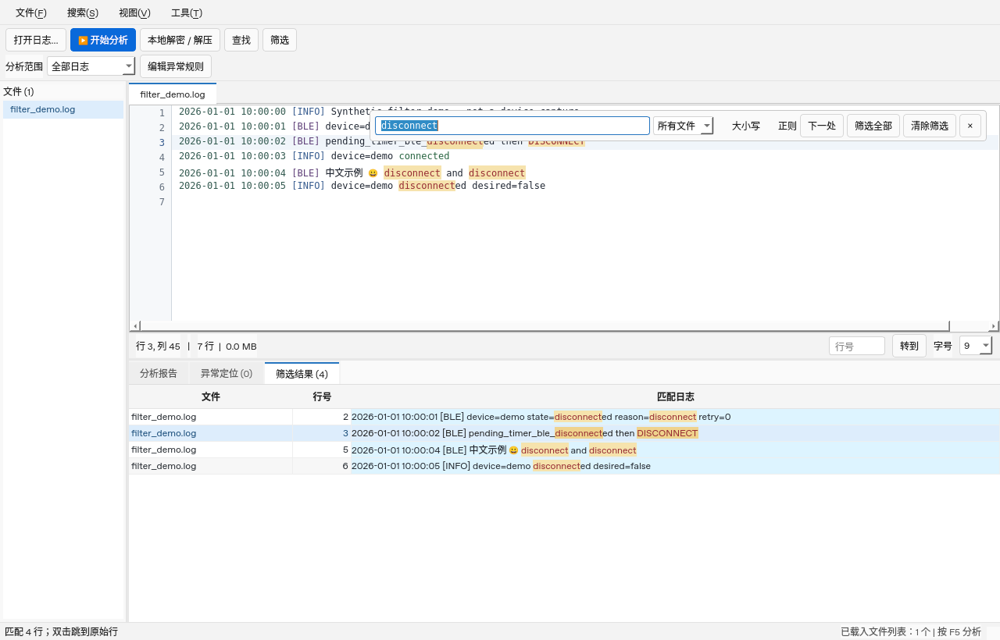

# RayNeo Log Tool

基于你提供的 `RayNeo_Log_Tool.py` 和 `异常判定规则.json` 修改的桌面日志工具。采用轻量模块化项目：仍只有一个启动入口，不需要服务器、数据库或账号。原始上传文件与 ADClose 仓库均未修改。

## 1.4.0 性能与连接证据判定

- 分析、查找和筛选运行在独立进程，避免耗时正则持有 GUI 的 Python GIL；顶部“取消任务”可停止这些进程。读取、解包仍由后台线程处理并检查取消信号。完整日志与分析缓存保留在分析进程，GUI 只缓存最近查看的 3 个文件。
- 搜索筛选框常驻顶部，可点“悬浮搜索”或拖出；关闭浮动搜索会回到顶部。筛选结果默认自动悬浮，关闭浮窗回到底部且保留命中标记。取消勾选“筛选结果自动悬浮”即可固定使用底部面板。
- 顶部提供打开、分析、取消、报告、导出、悬浮、本地解密/解压等按钮，小窗口通过工具栏右侧箭头展开。默认导入后自动分析，完成后弹出可继续操作主窗口的报告窗口；可以取消自动分析，只预览日志。
- 报告窗口最多预览 10 万字，复制/导出使用完整报告；异常列表最多展示 2 万条，完整证据保存在报告中。筛选结果每行最多预览 8192 字，所有片段共用 800 万字的预览预算，双击仍能定位完整原文，不截断日志文件。
- BLE 超时、SPP 失败和 App 整体连接失败分开标注“已恢复 / 持续未恢复 / 待核实 / 正常操作关联”。短暂失败后成功不再与持续故障一起标红；缺少完整 90 秒观察或日志间隔超过 60 秒时，不确认持续故障。计数为 0、取消计时器、HTTP 正文等不作为失败回调；SPP 不借用 BLE 成功记录作为恢复证据。
- 增加 ANCS 建链/订阅/属性异常、手机通知转发/ACK 失败及权限未就绪检测。只关联同文件、兼容设备标识的时序证据；ANCS 前有 BLE 中断时提示关联，BLE 恢复后不继续套用旧断链原因。仅收到手机通知、勿扰过滤、RSSI 偏低不直接判为眼镜漏通知或蓝牙根因。
- 窗口与 Windows EXE 使用统一日志图标，资源保存在 `assets/`，无需新增运行依赖。

回归覆盖 94 项（本地 Linux / Qt offscreen），包括病态正则隔离与取消、自动报告、浮窗回收、恢复时序、不同设备/协议隔离、Unicode 复制及源码安装检查。Windows 包还必须通过 Actions 中的同一套测试与打包后 EXE 实际启动检查。

这些规则通过合成场景验证；尚未获得截图对应原始日志，因此没有真实误判率或设备覆盖率的统计。失败事件仍保留证据，并不会仅因为降级为“待核实”就被视为正常。大型任务仍会占用 CPU 和分析进程内存，独立进程不能保证所有大小的日志都在固定时间内完成。

合成大日志单次检查：5 个不同文件，合计 62,400,850 字节、600,015 行；本机 Linux / Qt offscreen 首次分析 2.857 秒、缓存重分析 1.747 秒、全文件关键词筛选 0.760 秒。分析期间 10 ms 界面计时器的最大回调间隔为 29.4 ms。此样例以普通心跳行为主，不代表复杂真实日志性能，也没有与旧版做等条件比较。[测量记录](docs/performance-sample-1.4.json)，可用 `python tools/benchmark_responsiveness.py` 重测。

最新 Windows 程序包请从 [Build Windows EXE](https://github.com/gaoyinhui1-wq/RayNeo-Log-Tool/actions/workflows/build-windows.yml) 的 **1.4.0 成功运行记录**下载 `RayNeo-Log-Tool-Windows-x64`，完整解压后使用。下方 1.3.2 链接是旧版，不含上述更新。

## 1.3.2 Windows 自动构建（历史版本）

本次 **Windows x64 程序包（1.3.2）已构建并通过验收**，大小约 40 MB：

- [下载 Windows 程序包（需要登录 GitHub）](https://github.com/gaoyinhui1-wq/RayNeo-Log-Tool/actions/runs/41592923063/artifacts/13210513285)
- [查看成功构建记录](https://github.com/gaoyinhui1-wq/RayNeo-Log-Tool/actions/runs/41592923063)

在 GitHub Windows runner 上，74 项回归测试和打包后 EXE 的实际运行检查均通过。源码提交为 `a475f8b`，程序包包括 EXE、`_internal`、规则 JSON 和使用说明。解压后双击 EXE 即可，无需安装 Python。该 Actions 产物保留 30 天，到期可重新运行构建。

仓库新增 `Build Windows EXE` 工作流。更新主分支相关源码或在 Actions 页面点击 Run workflow，会在 Windows x64 / Python 3.12 环境运行测试、打包并实际启动生成的 EXE，检查导入、分析、筛选、复制以及加密/解压依赖。

构建通过后，进入 [Windows 构建页面](https://github.com/gaoyinhui1-wq/RayNeo-Log-Tool/actions/workflows/build-windows.yml)，打开成功的运行记录，在 Artifacts 中下载 **RayNeo-Log-Tool-Windows-x64**。需要登录 GitHub；下载完整解压后双击 `RayNeo_Log_Tool.exe`，无需安装 Python。`Windows-build-diagnostics` 是诊断文件，不是应用程序。

自动构建状态及产物以对应运行记录为准；仅推送工作流不代表 EXE 已构建成功。

## 1.3.1 启动缺文件提示

若更新时漏掉项目模块，入口会明确显示缺少哪个文件和恢复方法；第三方依赖错误仍保留原始错误信息。

遇到 `ModuleNotFoundError: No module named 'rayneo.matching'` 时，请重新下载完整 ZIP 并解压到一个新目录。`matching.py` 是程序自带源码，新版 `search.py` 需要它；还需要同版本的 `result_delegate.py` 等文件。请勿只替换个别 Python 文件或混用新旧目录。

进入新项目目录后，可以在 PowerShell 检查：

```powershell
Test-Path .\rayneo\matching.py
Test-Path .\rayneo\result_delegate.py
python .\RayNeo_Log_Tool.py
```

前两行应均返回 `True`。若你修改过规则，请把旧目录的 `异常判定规则.json` 复制到新目录。已安装依赖的虚拟环境可以继续用于运行源码。

## 1.3 筛选命中标记

- 下方“筛选结果”的匹配片段显示为 **深红文字 + 浅黄色底色**，同一行的多处命中都会标出，选中结果行时仍能看清。
- 原始日志区同步标记这些结果对应的命中位置；切换文件时恢复对应文件的标记。原文和复制内容保持不变。
- 大小写、正则与命中位置由同一次后台筛选计算。结果保存当时的筛选条件：即使后来修改输入框、大小写或正则开关，双击旧结果仍定位到原先的命中片段。
- “清除筛选”会清空结果和标记，保留输入条件；清空输入框也会清除。新导入、新分析和失败的正则筛选不会留下上次结果的标记。
- 绘制只使用后台返回的位置，不在界面线程中重新执行搜索正则；只排版可见文本，超长结果仍保留原文供定位和查看。原文标记范围随现有 2.5 万条筛选结果上限，不额外全量扫描其余日志。
- 零宽正则命中以细标记线表示，不会把整行误染色。中文、Emoji、横向滚动、结果省略显示及连续密集命中均有回归测试。

可打开 `examples/filter_demo.log`，输入 `disconnect` 并点击“筛选全部”试用。



## 1.2 更新

- 日志区支持鼠标拖选任意片段、跨行选择、Shift 扩选、双击选词、Ctrl+C、右键复制及 Ctrl+A。未选中文本时 Ctrl+C 复制当前行。选择位置保留源文本坐标，兼容中文、Emoji、制表符和 CRLF；仍然只绘制可见行，不创建百万行文本控件。
- 修正正文误用行号灰色画笔的问题，并将语义色调整为更深的低饱和配色。
- 顶部工具栏增加“本地解密 / 解压”，保留原工具菜单入口。
- 导入窗口左侧增加系统 Downloads 快捷路径，兼容系统重定向的下载目录。
- 修复快速切换到有文本缓存但无行索引的文件时一直显示“读取中”、旧线程回调清掉新线程引用、Unicode 搜索定位偏移、行索引未就绪时跳错行、空导入残留旧内容，以及长行超过 1,000 字符后无法继续横向浏览的问题。同名日志可以悬停查看完整路径。

更新源码时请先关闭程序，保留你自行修改的 `异常判定规则.json`；旧 EXE 不会自动更新，需要用新源码重新打包。

## Windows 启动

1. 安装 **64 位 Python 3.10 或更新版本**，安装时勾选“Add Python to PATH”（推荐 3.12）。
2. 将整个 ZIP 解压到一个普通可写目录，保留 `rayneo` 文件夹和 JSON。
3. 首次双击 **`安装依赖.bat`**，等待安装完成；然后双击 **`start.bat`**。
4. 后续直接双击 `start.bat`。首次安装需要联网，查看/解密/分析日志均在本地进行。

也可以在项目目录的终端执行：

```console
python -m venv .venv
.venv\Scripts\python -m pip install -r requirements.txt
.venv\Scripts\python RayNeo_Log_Tool.py
```

Linux/macOS 使用对应虚拟环境的 `python` 安装依赖并运行入口；图形桌面需要本机 Qt 所需系统库。依赖版本是本次 Python 3.12 测试使用的版本，不是 Windows 平台兼容性保证。

## 使用

- **Ctrl+O / 打开日志**：直接打开一个文件选择器；选择普通文件、压缩包或文件夹，按“导入”。按住 Ctrl 可以混选文件与文件夹；双击文件夹仍是进入目录浏览。左侧可以直接进入 Downloads。
- 也可以把文件、文件夹和压缩包一起拖进主窗口。不再先询问“压缩包还是文件夹”。
- 默认导入后自动分析并显示报告；取消顶部自动分析勾选后，可按 **F5 / 开始分析** 手动执行。重复分析复用内容和索引缓存；源文件或规则修改后缓存自动失效。
- **Ctrl+F** 查找，**Ctrl+Shift+F** 筛选；双击筛选结果或异常定位跳回原文。
- **Ctrl+G** 聚焦行号输入，**Ctrl+E** 导出报告。顶部“本地解密 / 解压”可直接打开本地处理工具。
- 在日志区拖选文本后按 **Ctrl+C** 或右键复制；支持跨行、Shift 扩选、双击选词和 **Ctrl+A**。不选择时复制当前行。
- “编辑异常规则”打开程序目录中的 JSON，保存后重新分析生效。日志行号、原文和 VS Code Light+ 日志颜色保持原有风格；外层菜单、按钮、标签采用简洁的 Notepad 风格。

`examples/demo.log` 是随包提供的合成演示日志，可以用它快速试用界面；不是设备真实采集记录。

## 支持的输入

普通文本不限制扩展名，支持 UTF-8、UTF-16 和 GB18030；容器支持 ZIP、TAR、TAR.GZ/TGZ、TAR.BZ2、TAR.XZ、GZIP、BZ2、XZ、LZ4、VLOGA1 及这些格式的嵌套。自动识别内容；VLOGA1 保留原有 AES-GCM 认证。

RAR、7z 未加入解码器，会提示先解压再导入文件夹；“所有文件”表示选择器不按扩展名隐藏文件，不表示任意二进制格式都能作为文本分析。导入失败详情在报告区显示，损坏压缩包不再冒充原始文本进入分析。

## 主要修改

- 原单文件拆为界面、显示、导入、规则、索引、诊断、设备信息、功能关联、报告及后台任务模块。
- 启动界面不加载诊断引擎、加密、LZ4 或原生索引器；按需加载。去除未使用的导入，不再加载可选 QScintilla。
- 日志仍只绘制可见行；预览的内容可供分析复用。切换导入后释放旧索引；后台任务结果完成 UI 更新前保持忙碌状态，避免旧结果覆盖新筛选。
- 引入 Aho–Corasick 多关键词索引，缺少加速器时有标准库回退。正则必要字面量通过保守解析提取；不确定的表达式回退扫描，用户提供的索引词不能改变匹配结果。
- 规则补报遵守“同一行必须包含”；自定义状态搜索进入索引；禁用的同名规则不再被内置规则补回。
- 时间关联遵守时间与行顺序，不把同秒较早的日志当成后续证据。分析时间边缘的恢复上下文仍会检查。
- “超时未恢复”要求完整观察窗口，并排除正常操作；默认相邻带时间日志最大间隔 **60 秒**，大空档不作为持续失败证据。可在对应 JSON 规则中设置正数 `"最大日志间隔秒": 60` 调整；日志本来很稀疏时，保守策略可能不输出该类问题。
- 文件去重先快速筛选，再按完整内容哈希确认；不再丢掉头尾相同但中间不同的日志。
- 修复 PyQt6 查找高亮坐标返回 tuple 引发的崩溃；修复原代码 PID 正则未定义。报告导出保留完整内容，不受界面显示长度上限影响。
- 日志区维持水平滚动；原本不起作用的“自动换行”控件已去掉。没有引入需要全量排版的新控件。

## 项目结构

| 文件/模块 | 用途 |
| --- | --- |
| `RayNeo_Log_Tool.py` | 启动入口 |
| `rayneo/app.py`, `window.py`, `dialogs.py`, `theme.py` | 应用、主窗口、统一导入窗口和主题 |
| `rayneo/viewer.py`, `search.py`, `text.py` | 可见行绘制、后台搜索、结果模型及行偏移 |
| `rayneo/matching.py`, `result_delegate.py` | 冻结筛选条件、原文命中位置及筛选结果片段标记 |
| `rayneo/ingestion.py`, `background.py` | 文件收集、容器处理和预览/读取任务 |
| `rayneo/rules.py`, `rule_engine.py` | 规则文件管理和五种 JSON 判定逻辑 |
| `rayneo/indexing.py`, `records.py`, `timestamps.py` | 多关键词索引、缓存、观察范围和时间 |
| `rayneo/analysis.py`, `analysis_worker.py` | 原有高级诊断与分析后台任务 |
| `rayneo/device_info.py`, `features.py`, `reporting.py` | 设备信息、功能上下文和报告 |
| `tests/`, `tools/benchmark.py` | 回归测试及可复现性能测试 |

JSON 保留你上传的规则内容。本次重点修复执行逻辑，没有重新定义硬件定责标准，也没有伪造真实日志样本。

## 验证与性能

在 Linux、Python 3.12.14、PyQt6 6.12.0 的 `offscreen` 平台完成 **74 项 unittest 回归测试**，含真实 Qt 后台导入→预览→分析→重复分析→筛选流程、混合导入选择器、Unicode 高亮、真实鼠标和键盘选择、Downloads 快捷入口、文件切换竞争、筛选标记实际绘制/清除/异步导航、独立源码副本启动及故意移除模块后的恢复提示、加密认证、嵌套容器及规则误判边界。结果见 `validation.txt`。另通过 Python 编译检查和 Ruff 未定义名称检查。

以下为 1.1 版本保存的基准结果（本轮未改动候选索引算法）：同一机器、5 次中位数、100,000 行 / 5,587,514 字节合成日志、相同启用规则。后续版本的界面启动耗时未重新测量：

| 测试项 | 原版 | 修改版 |
| --- | ---: | ---: |
| 冷建候选索引 | 0.225 秒 | 0.081 秒 |
| 新进程创建并离屏显示主窗口 | 0.159 秒 | 0.140 秒 |

该场景两版都找到 200 条相同的候选原文。索引约快 2.8 倍；此结果不是全流程耗时或 Windows EXE 启动速度保证。第一次构建、冷磁盘、复杂正则、时间规则和实际日志分布都会影响耗时。详见 `benchmark-results.json`。

运行测试：

```console
python -m unittest discover -s tests -v
python tools/benchmark.py
python tools/benchmark.py --baseline /path/to/original/RayNeo_Log_Tool.py
```

无图形桌面时设置 `QT_QPA_PLATFORM=offscreen`。纯解析测试可以单独运行 `python -m unittest discover -s tests -p test_core.py -v`。

## 在 Windows 本地构建 EXE

安装完依赖后，双击 `tools/build_windows.bat`。也可以在已激活虚拟环境的 PowerShell 中执行：

```powershell
python -m pip install "pyinstaller>=6.10,<7"
python .\tools\build_windows.py
```

脚本必须在 Windows x64 和 64 位 Python 上运行，会先检查源码导入，再生成并验收 `dist\RayNeo_Log_Tool\RayNeo_Log_Tool.exe`，最后输出 `dist\RayNeo-Log-Tool-Windows-x64.zip`。脚本采用 **onedir**，减少每次启动解压 Qt 的开销；分发时须保留整个输出目录，包括 `_internal` 和规则 JSON。

打包后的验收报告为 `dist/build-smoke-test.json`。构建失败时脚本会返回非零退出码，不会把失败验收当成成功构建。

## 仍需实测的范围

- 尚未收到真实误判日志，不能承诺已消除全部误判；本次通过的是针对已定位代码缺陷的回归测试。
- 已在 GitHub Windows x64 runner 验证构建、回归测试及打包后程序的离屏运行；用户电脑上的实际桌面交互、特殊权限和真实日志仍需复测。
- JSON 的局部时间关联仍以单个文件为证据范围。跨文件、多设备的关联沿用原有高级诊断流程；文件轮转或多设备混合日志还需真实样本校验，未改造为完整的按设备分流状态机。
